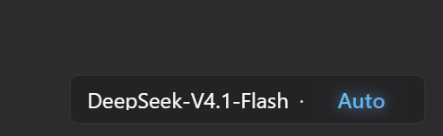
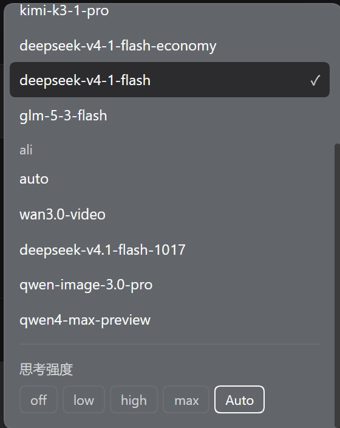

# Thinking effort autoswitcher

**English** | [简体中文](README.zh-CN.md)





A DSH plugin that turns the composer model selector into a compact
model + thinking-effort picker, adds an `Auto` level, and shows the effort each
turn actually used.

Version **0.1.0**. Scope and limitations are listed
[below](#known-limitations).

## What it does

- **Model + effort picker** — replaces the `conversation.input.model` slot. The
  menu lists models grouped by provider, then the current model's real effort
  levels (`off` / `low` / `high` / `max`, whatever the provider exposes) and an
  `Auto` entry.
- **Arrow cycling** — `←` decreases, `→` increases. The ladder is
  `[real levels…, Auto]`: `→` from the highest level lands on `Auto`, `←` from
  `Auto` returns to the highest level. There is no wrap-around.
- **↑ ↓ switches model** — walks the catalog in order (provider groups first,
  then models inside each group) one step per press, also stopping at the ends;
  the new model lands on its middle effort.
- **Caret-safe by opt-in** — arrows cycle anywhere, including inside a text field
  with content; the cost is that arrows no longer move the caret there. Set
  `localStorage['thinking-effort:caret-priority'] = '1'` and reload to give the
  caret priority again.
- **Slide animation** — the effort word in the button slides horizontally
  (old word out, new word in) inside a fixed-width slot, so the button never
  jumps; the word uses a flowing cool-tone gradient with a light glow.
- **Per-turn real effort** — while `Auto` is on, each completed turn shows the
  effort that turn **actually sent** (read from `request/header` events, not
  from the current picker state). Turns without a recorded header show
  `default`.
- **Escape hatch** — if the replacement picker misbehaves, keep the plugin but
  set `localStorage['thinking-effort:no-replace'] = '1'` and reload: a compact
  effort chip in `conversation.input.left` takes over.

## Install

Link the plugin into the profile's dependencies and list it in
`dsh.profile.bundles`; the bundle's own `cordis.patch.yml` inserts the loader
row, so the profile patch needs no extra entry.

```jsonc
// ~/.dsh/profiles/<profile>/package.json
{
  "dependencies": { "dsh-thinking-effort-autoswitcher": "link:C:/path/to/thinking-effort-plugin" },
  "dsh": { "profile": { "bundles": ["...", "dsh-thinking-effort-autoswitcher"] } }
}
```

Then **fully restart DSH** (the Host half only loads at startup).

## Auto scoring (Host half)

The Host exposes two same-origin JSON routes:

| Route | Purpose |
| --- | --- |
| `POST /thinking-effort/evaluate` | score the current turn and return a target level; `apply: true` applies it |
| `POST /thinking-effort/turns` | return the effort each turn actually sent (from `request/header`) |

### How the score is built

- **failure (0–5, deterministic)** — only the **latest turn**. A tool call
  failing ≥2 times with the same name and arguments is one repeat group worth
  2; a `turn/end` with `reason.kind === 'error'` adds 2; capped at 5.
- **importance (0–10, judged)** — one small model call comparing the latest
  user message against an anchor. The anchor is the **active goal objective**
  when a goal is running, otherwise the first user message. Closer to the
  anchor and larger blast radius score higher; peripheral exploration scores
  lower. The judge uses the model's lowest level (preferring `off`); if the
  reply cannot be parsed the score falls back to 5 and `importanceRaw` is
  returned for debugging.
- **mapping**:

  ```
  total    = wI * importance + wA * failure
  maximum  = wI * 10 + wA * 5
  interval = maximum / levelCount
  index    = floor(total / interval)   // clamped to 0 … levelCount-1
  ```

  Weights live in the plugin's patch row and only their ratio matters:

  ```yaml
  - insert:
      - id: thinking-effort
        name: 'dsh-thinking-effort-autoswitcher'
        config:
          weights: { importance: 1, failure: 1 }
  ```

### When the Client calls it

- switching to `Auto` evaluates **immediately** (cold start lands on the middle
  level first);
- each completed turn evaluates once from the turn-tail tag, debounced 600 ms,
  at most once per turn;
- a 404/405 marks the route unavailable and stops further calls; the menu shows
  “auto scoring not connected” instead of silently retrying.

### Per-turn history

`/thinking-effort/turns` groups `request/header` events between `turn/start`
and `turn/end`:

```json
{"ok":true,"turns":[{"turn":1,"effort":"low","seq":18,"endSeq":100}]}
```

The Client caches the answer per session, matches each turn-tail entry by its
closing `seq` (then by the last `endSeq <= seq`, then by turn number), and
shows that recorded effort; only when the route is unavailable does it fall
back to the live selection.

## Activation notes

The Host half loads only when:

1. the plugin is linked into the profile's `node_modules`;
2. a loader row exists for it (the bundle patch already inserts one);
3. `index.js` exports `export const inject = ['webServer']`.

Point 3 bit this plugin once: without a declared dependency, `apply` can run
before the HTTP carrier exists, `ctx.get('webServer')` is `undefined`, the code
silently returns, and the plugin still reports `fiberPhase: active` while every
request falls through to the SPA fallback (405 with `allow: GET, HEAD`).

Self-check:

```powershell
curl.exe -s -X POST "http://127.0.0.1:<port>/thinking-effort/evaluate" `
  -H "content-type: application/json" -H "sec-fetch-site: same-origin" `
  -d '{"sessionId":"probe"}'
```

A structured JSON answer (for example `{"ok":false,"error":"session-not-live"}`)
means the route is live; 405 means it is not.

## Known limitations

- The per-turn tag prefers the recorded `request/header` effort; it falls back
  to the current selection only when the route is unavailable. Turns with no
  recorded header (for example a cancelled turn) show `default`.
- `conversation.input.model.label` contributions from other plugins are not
  forwarded.
- The menu has no search box and no roving keyboard focus.
- `selectModel` may be refused while an agent is running; the response carries
  `applied: false` with `applyError`, and the UI keeps the manual choice.

## License

MIT — see [LICENSE](./LICENSE).
